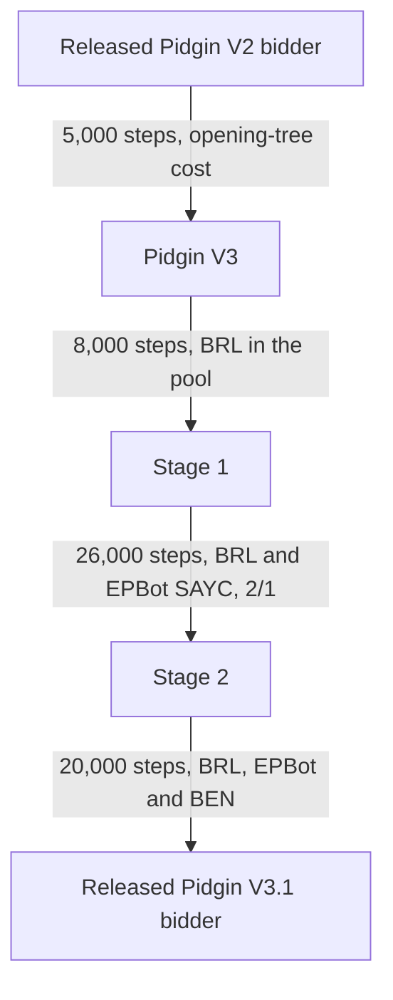

# Pidgin V3.1 bidding

Pidgin V3.1's released bidder is `pidginv3_1_bid_s20000.pt`. The `PidginV3.1` team
bids with the network alone, without bidding search, and plays the cards with the
[Pidgin Q-net card-play model](card_play.md). It is the default team of the Docker
image and the default bidder of the table at <https://bridge.localgeek.jp/>.

To ask the released Pidgin V3.1 bidder for a call:

```bash
python -m pip install -e .
python -m pip install -r server/requirements.txt
scripts/get_models.sh
python scripts/bid.py AKQ2.JT9.876.543 --auction "1H P" --model PidginV3.1
```

## How it was trained

Pidgin V3.1 starts from Pidgin V2 and keeps V2's costs on code words (0.2) and on
weak opening bids (0.5). Two things are new:

- **Opening-tree cost (Pidgin V3).** A small decision tree, 32 leaves, is refit every
  250 steps on the model's own recent openings. An opening that the tree would not
  make costs 30 points. This makes the openings easy to describe with a few rules.
- **Outside bidders as opponents.** Part of each training batch is played against
  bidders that we did not train: BRL, EPBot (SAYC and 2/1) and BEN (GIB, SAYC and
  2/1 game force).



| Stage | Start from | Steps | Outside bidders (share of games) |
|---|---|---|---|
| Pidgin V3 | Pidgin V2 | 5,000 | none |
| 1 | Pidgin V3 | 8,000 | BRL (0.2) |
| 2 | Stage 1 | 20,000 + 6,000 | BRL, EPBot SAYC, EPBot 2/1 (0.3) |
| 3 | Stage 2 | 20,000 | BRL, EPBot SAYC, EPBot 2/1, BEN GIB, BEN SAYC, BEN 2/1 (0.4) |

Every stage also plays a league of its past checkpoints (0.2) and a
perfect-information punisher that doubles (0.3 to 0.4), with V2's other settings
(`--pg-lr 3e-5`, 2,048 episodes per step, doubles at any seat).

These runs were made outside this repository, and they need the outside bidders
installed. This repository does not contain the training code for the opening-tree
cost or the outside-bidder pool, so you cannot retrain Pidgin V3 or V3.1 from it.
The outside bidders are:

- BRL: [harukaki/brl](https://github.com/harukaki/brl) (its weights ship here as `brl_fsp_weights.npz`).
- EPBot: [Edward Piwowar's bridge bidding engine](https://sites.google.com/view/bbaenglish).
- BEN: [lorserker/ben](https://github.com/lorserker/ben), its GIB, SAYC and 2/1 bidding models.

## Results

Bidding only: both tables play each deal double dummy. 10,000 fresh deals that were
not used in training, 16 boards per deal (4 dealers × 4 vulnerabilities), each played at two tables, so
160,000 boards per match. IMPs per board for Pidgin V3.1, with a 95% interval.

| Opponent | IMPs/board |
|---|---|
| BRL | +0.20 ± 0.06 |
| EPBot SAYC | +1.07 ± 0.07 |
| EPBot 2/1 | +1.12 ± 0.07 |
| BEN GIB | +1.43 ± 0.07 |
| BEN SAYC | +1.45 ± 0.07 |
| BEN 2/1 game force | +1.44 ± 0.07 |
| Pidgin V1 bidder | +0.46 [+0.41, +0.51] |
| Pidgin V2 bidder, no search | +0.02 [−0.01, +0.06] |
| Pidgin V3 | +0.04 [+0.01, +0.07] |

For comparison, Pidgin V3 on the same deals scored −0.16 [−0.22, −0.10] against BRL
and +0.81 against EPBot SAYC.

Simplicity: a three-rule summary (open a suit from 9 HCP, 1NT from 19, a weak two up
to 8) gives the same opening call as Pidgin V3.1 on 87.5% of 100,000 hands in second
seat, not vulnerable. Pidgin V3 agrees on 84.6%. See [simplicity.md](simplicity.md).

Pidgin V3.1 uses more code words than V3: about 12 per 100 calls against about 8.
