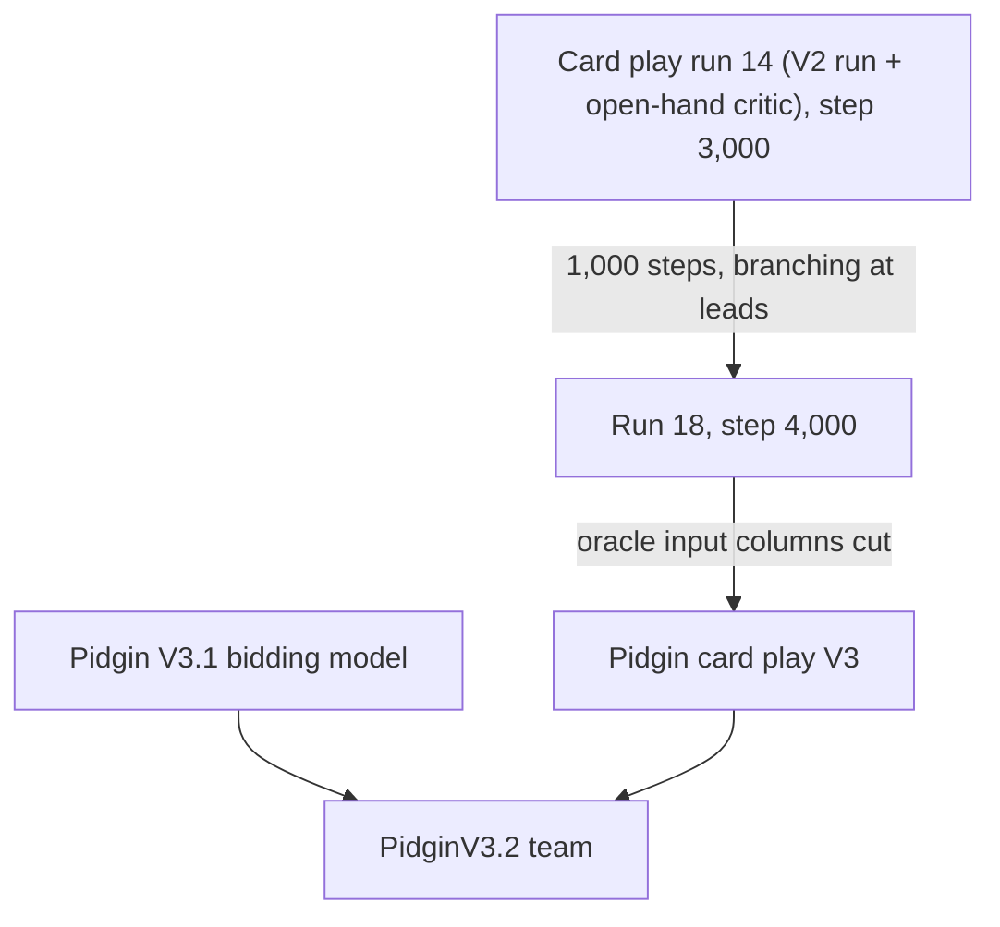

# Pidgin V3.2

Pidgin V3.2 is the default team of the table at <https://bridge.localgeek.jp/> and of the
Brill and BBO APIs. Its team ID is `PidginV3.2`. It bids with the
[Pidgin V3.1](pidgin_v3_1.md) bidding model (`pidginv3_1_bid_s20000.pt`), without bidding
search, and plays the cards with [Pidgin card play V3](card_play.md#card-play-v3)
(`play_run18_s4000.pt`), without search. The table shows it as **Pidgin V3.2**
("Bidding: V3.1 (VieNNa system) · Card play: V3").

The only difference from the `PidginV3.1` team is the card player. `PidginV3.1` stays on the
site and the APIs with card play V2, and rated challenges are still played against it.

To ask Pidgin V3.2 for a call:

```bash
python -m pip install -e .
python -m pip install -r server/requirements.txt
scripts/get_models.sh
python scripts/bid.py AKQ2.JT9.876.543 --auction "1H P" --model PidginV3.2
```

## How it was trained

The bidding model is the released Pidgin V3.1 bidder; see [Pidgin V3.1](pidgin_v3_1.md).
Card play V3 continues the self-play card-play training of card play V2 (deep Monte Carlo,
inspired by DouZero) with an open-hand critic and true-deal branching at leads; see
[Card play V3](card_play.md#card-play-v3). The trainer is `cardplay/`; to train it, see
[Train card play V2 and V3](card_play.md#train-card-play-v2-and-v3).



### Outside bots

The bidding model learned partly against bidders that we did not train and do not ship:
BRL ([harukaki/brl](https://github.com/harukaki/brl); its weights ship here as
`brl_fsp_weights.npz`), EPBot SAYC and 2/1
([Edward Piwowar's engine](https://sites.google.com/view/bbaenglish)) and BEN GIB, SAYC and
2/1 game force ([lorserker/ben](https://github.com/lorserker/ben)). See
[Pidgin V3.1](pidgin_v3_1.md#how-it-was-trained) for the share of games against each. The code
that plays them in training is not in this repository.

Card play V3 learned only against itself and its own past snapshots. The Q-net served as the
evaluation opponent; it is not a training opponent.

## Results

Card play only: the Pidgin V3.1 auctions are fixed in advance (dataset contract rows 1,000
to 9,989, 8,990 boards), both sides play greedy without search. IMPs per board with a 95%
interval:

| Match | IMPs/board |
|---|---|
| Card play V3 vs the Pidgin Q-net, both chairs | +0.834 ± 0.051 |
| Card play V2 vs the Pidgin Q-net, both chairs (same boards) | +0.688 ± 0.052 |
| Card play V3 vs card play V2, duplicate | +0.294 ± 0.090 |
| of which declarer play | +0.217 ± 0.080 |
| of which defence | +0.075 ± 0.078 |

The bidding is the same as Pidgin V3.1, so the bidding results in
[Pidgin V3.1](pidgin_v3_1.md#results) apply to Pidgin V3.2.
